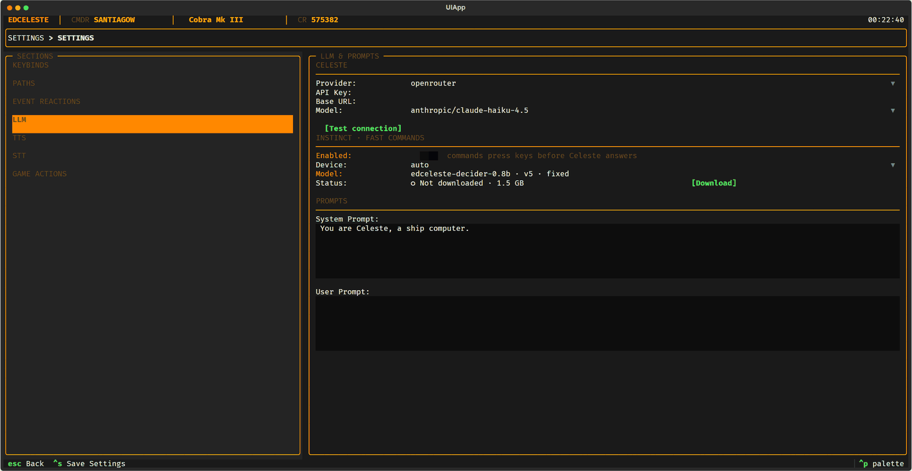
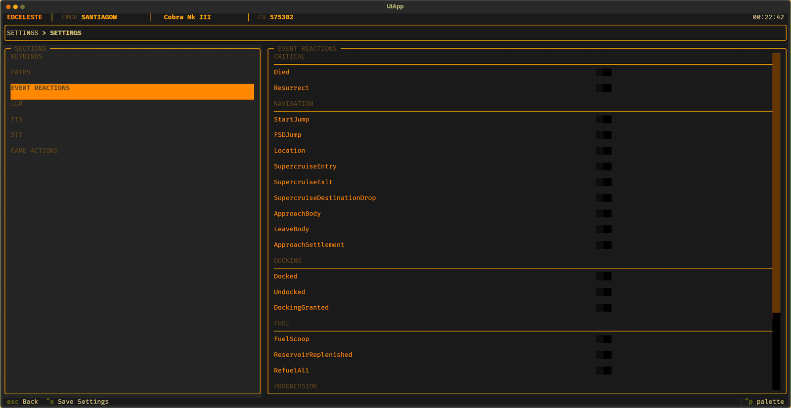
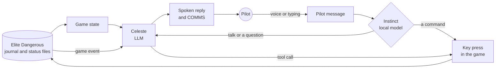

<p align="center">
  <picture>
    <source media="(prefers-color-scheme: dark)" srcset="docs/celeste-logo-dark.png">
    
  </picture>
</p>

# EDCeleste

[](https://github.com/IqSantiagow/EDCeleste/actions/workflows/pr-pipeline.yml?query=branch%3Amain+event%3Apush)
[](https://iqsantiagow.github.io/EDCeleste/)

A voice co-pilot for Elite Dangerous that lives in your terminal.

Celeste follows your game as it happens, talks with you, and presses keys for you. Say "deploy landing gear" and the gear moves. Ask "how much fuel do I have?" and she answers from what the game just wrote.


> **Status:** in active development. Game state, the LLM co-pilot, voice in and out, key presses, fast commands and event reactions work today. Next: a command combined with a question.

## What Celeste does

- **Knows your game.** She reads the game's journal live: where you are, what you fly, your fuel and cargo. Start the app mid-session and she is up to date from the first second.
- **Listens.** Speak instead of typing. Speech is turned into text on your machine.
- **Talks back.** A Microsoft Edge voice or your own cloned voice, with an optional "ship computer" effect.
- **Presses keys.** She uses your own keybindings and presses keys only into the game window. Off until you switch it on.
- **Reacts quickly (Instinct).** A tiny local model recognises a command in about a millisecond and presses the key without waiting for the LLM. [More about Instinct](docs/INSTINCT.md).
- **Reacts to the game.** Pick the events she should speak up about, for example docking.
- **Works with any LLM.** OpenRouter by default; Anthropic, OpenAI, Google, Groq, Mistral or a local server work from settings alone.

## Screenshots

**Start-up check.** Every service is checked before the dashboard opens.


**Settings.** The LLM, Instinct, prompts and event reactions.

| LLM and Instinct | Event reactions |
| --- | --- |
|  |  |

## How it works



| The pilot says or the game does         | Who handles it                                      |
|-----------------------------------------|-----------------------------------------------------|
| "Deploy landing gear"                   | Instinct presses the key                            |
| "How much fuel do I have?"              | Celeste answers                                     |
| A game event you switched on            | Celeste speaks up                                   |

## Roadmap

| Milestone | What the pilot gets |
|-----------|---------------------|
| M1 · Fast commands | A command happens in about a second and Celeste confirms it, without waiting for the LLM. |
| M2 · Celeste knows the game | From the first second Celeste knows the route, cargo and modules, and follows a game restart. |
| M3 · Reflex API | One list of reactions: an instant rule, or Celeste judging the moment with your own prompt. |
| M4 · Cockpit cards | Cards for the ship, route, station and system next to the conversation. |

## Getting started

**You need:** Windows 10 or 11, Python 3.12+ and Elite Dangerous (PC). An NVIDIA GPU is optional; it only makes the Chatterbox voice fast.

```bash
git clone https://github.com/IqSantiagow/EDCeleste
cd EDCeleste
python -m venv .venv
.venv/Scripts/activate
pip install -e .
cp .env-example .env
edceleste
```

The first start creates `config.yaml` and asks you to fill in three things, then restart:

- `paths.journal_path`: your journal folder, usually `C:\Users\<you>\Saved Games\Frontier Developments\Elite Dangerous`
- `paths.keybindings_path`: your bindings folder, usually `C:\Users\<you>\AppData\Local\Frontier Developments\Elite Dangerous\Options\Bindings`
- `llm.provider.api_key`: the key of your LLM provider (OpenRouter by default)

Everything else is set in the app under **Settings** (`Ctrl+R`). `config-example.yaml` shows every option.

| Key      | Where     | Action                            |
|----------|-----------|-----------------------------------|
| `Ctrl+R` | Dashboard | Open settings                     |
| `Ctrl+E` | Dashboard | Toggle the ship log to full width |
| `Ctrl+S` | Settings  | Check and save settings           |
| `Esc`    | Settings  | Back to the dashboard             |
| `Ctrl+C` | Anywhere  | Quit                              |

## Development

```bash
pip install -e ".[dev,test]"
ruff check
mypy
coverage run -m pytest
```

How the code is organised, and how to add a new game event, is in [CONTRIBUTING.md](CONTRIBUTING.md).

## License

[MIT](LICENSE)

### Credits

The Pocket TTS voice engine runs [Pocket TTS](https://github.com/kyutai-labs/pocket-tts) by Kyutai (CC BY 4.0) through ONNX Runtime. The ONNX export of the model and the code that runs it are [pocket-tts-onnx](https://github.com/thewh1teagle/pocket-tts-onnx) by thewh1teagle (CC BY 4.0), copied unchanged into `src/pocket_tts_onnx` (see `VENDORED.md` there). The model is downloaded from its Hugging Face repository on first use.
