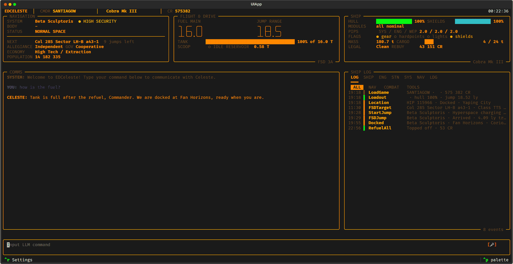
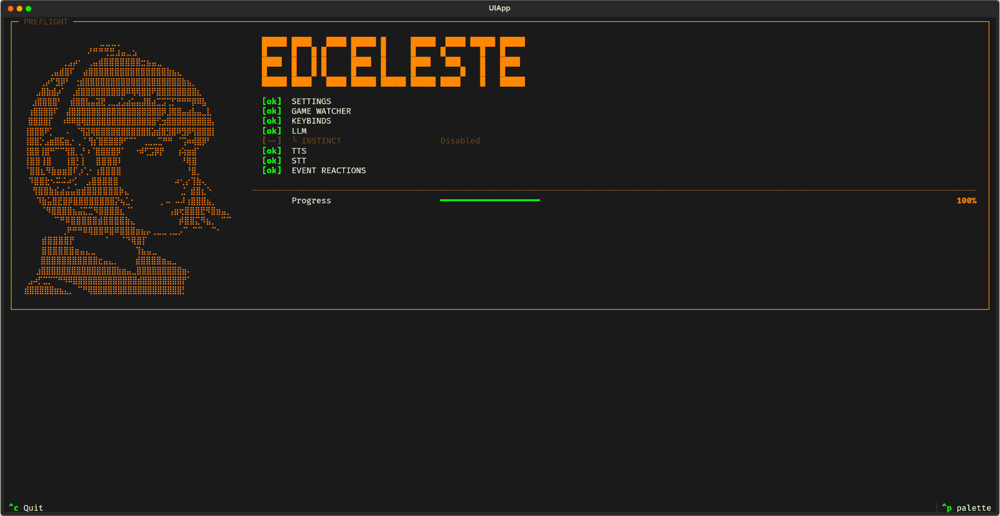
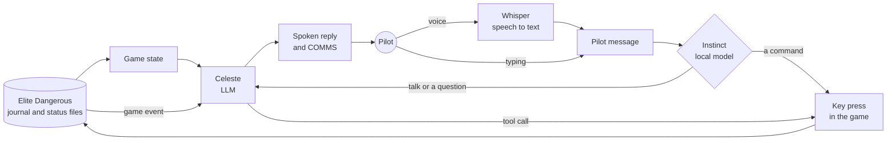
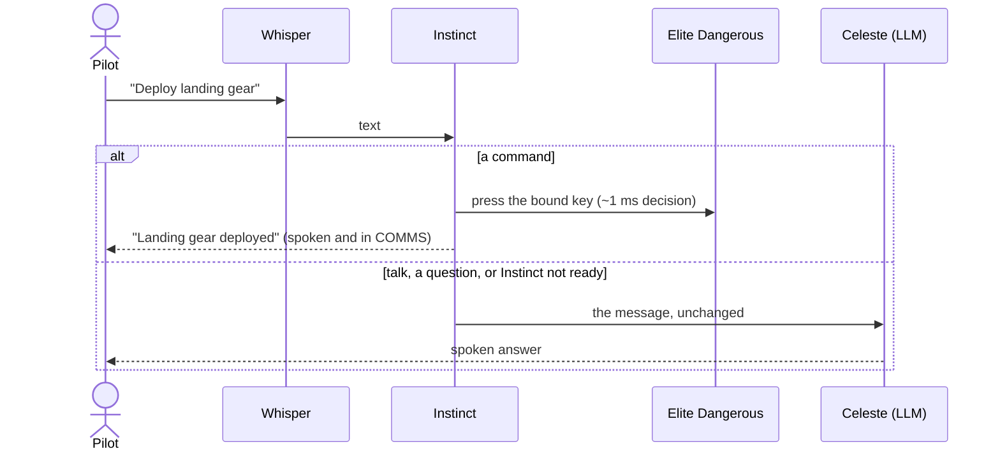
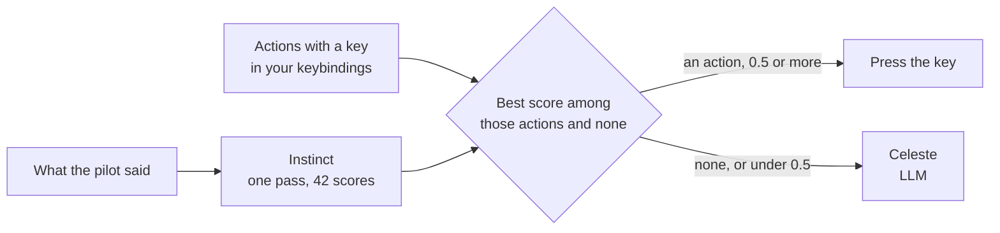
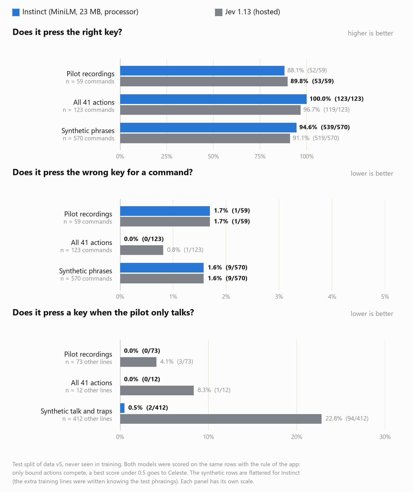

<p align="center">
  <picture>
    <source media="(prefers-color-scheme: dark)" srcset="docs/celeste-logo-dark.png">
    
  </picture>
</p>

# EDCeleste

[](https://github.com/IqSantiagow/EDCeleste/actions/workflows/pr-pipeline.yml?query=branch%3Amain+event%3Apush)
[](https://iqsantiagow.github.io/EDCeleste/)

A voice co-pilot for Elite Dangerous that lives in your terminal.

Celeste follows your game as it happens, talks with you, and presses keys for you. Say "deploy landing gear" and the gear moves. Ask "how much fuel do I have?" and she answers from what the game just wrote.



> **Status:** in active development. The game state, the LLM co-pilot, voice in and out, key presses and event reactions work today. Instinct, the local model for fast commands, presses the key for a single command. Before any key is pressed, by Instinct or by Celeste, the ship's state is checked: the landing gear, the cargo scoop and the hardpoints are refused when the ship cannot use them, and the reply says why. A command combined with a question and the "already deployed" check are next (M1 · Fast commands).

## What Celeste does

- **Knows your game.** She reads the game's journal and status files live: where you are, what you fly, your fuel, cargo and the station market. Every answer starts from that picture. Start the app in the middle of a session and she knows the situation from the first second: she reads the newest journal from the beginning in silence, with no reaction and no LLM request, and follows it live afterwards.
- **Listens.** Speak instead of typing. A local Whisper model turns speech into text on your machine, primed with Elite Dangerous vocabulary.
- **Talks back.** Replies are spoken with a Microsoft Edge voice, or with your own cloned voice running locally: Chatterbox (graphics card) or Pocket TTS (processor only, no graphics card memory). Voice profiles are recorded and managed in the app. One switch, the ship effect, makes her sound like the ship computer of the game: a slightly metallic, grainy voice with a light echo and the small room of a cockpit.
- **Presses keys.** She uses your own keybindings and presses keys only into the game window, never into the terminal. Off until you switch it on.
- **Reacts quickly to commands (Instinct).** A small model on your own machine (23 MB, no graphics card) recognises commands in about a millisecond and presses the key without waiting for the LLM. Everything else goes to Celeste.
- **Reacts to the game.** Pick the game events Celeste should speak up about, for example loading into the game or docking.
- **Works with any LLM.** OpenRouter by default; Anthropic, OpenAI, Google, Groq, Mistral or a local Ollama / vLLM server work from settings alone.
- **Runs in the terminal.** A start-up check, a cockpit dashboard with navigation, ship and comms panels, and a settings screen that checks every change before saving it.

## Screenshots

The app running on a recorded game journal: a jump to Beta Sculptoris, docking at Fan Horizons and a refuel.

**Start-up check.** Every service is checked before the dashboard opens: settings, the game journal, keybindings, the LLM, Instinct, voice out and in, and event reactions.



**Settings.** The LLM provider and model with a connection test, Instinct and its model download, the prompts, and the game events Celeste speaks up about.

| LLM and Instinct | Event reactions |
| --- | --- |
|  |  |

## How it works

### The big picture



The game state is the one picture of the game every part works from. It is rebuilt from the game's files the moment the game writes them.

### A voice command

Today every message goes to the LLM, which takes 5–6 seconds for a single key press. With Instinct, a command takes about a second:



Instinct presses a key only when the model picks a ship action. When the model picks `none` or is not sure (its best score is under 0.5), is not downloaded or loaded yet, or is too slow (more than 1 s), the message goes to Celeste as it always did, so nothing gets worse when it is off. When the model picks a ship action but game actions are switched off in the settings, no key is pressed and Celeste says "Game actions disabled" (the model is still asked first, so talk and questions still go to Celeste). The reply is short and the same in COMMS and in the speakers ("Landing gear deployed"). A toggle is named after the direction it went, read from the ship before the key was pressed. A refused action says so ("Landing gear unavailable"). Celeste plays the clip prepared for this text in the folder of the voice (`voices/<provider>/<profile>/replies/`), which starts at once. When the clip is missing, for example in a profile cloned before the text was added, Celeste speaks the text live, which is slower. A reply "already deployed" does not exist yet: the model picks a toggle, not its direction. When the pilot asks for an action while the game is not running, the reply says so at once ("Game window not found, nothing was pressed.") instead of waiting for Celeste to find out.

### Who handles what

| The pilot says or the game does         | Who handles it                                      |
|-----------------------------------------|-----------------------------------------------------|
| "Deploy landing gear"                   | Instinct presses the key                            |
| "How much fuel do I have?"              | Celeste answers                                     |
| "The landing gear looks nice"           | Celeste answers, no key is pressed                  |
| "Deploy the gear and tell me which pad" | Instinct presses the key, Celeste answers the rest (planned, M1.2) |
| A game event you switched on            | Celeste speaks up                                   |
| A game event with your own rule         | The rule presses a key or says a line at once (planned, M3) |

## Instinct, the command model

Instinct is the small model that decides who handles a message: a key press right now, or Celeste. It is [`IqSantiagow/edceleste-command-classifier`](https://huggingface.co/IqSantiagow/edceleste-command-classifier): all-MiniLM-L6-v2 with a 42-class head, in int8 ONNX, 23 MB. It knows the 41 ship actions the app can press and one more class, `none`.

### How it decides

Instinct is not a chatbot and never writes a sentence. It reads only what the pilot said (which action a command asks for does not depend on the game state) and scores all 42 classes in one pass.



- **Only actions with a key compete.** The best action among the ones you have bound, and `none`, is taken. It cannot press a key that does not exist.
- **There is a threshold of 0.5.** A best score under 0.5 counts as `none`, and the message goes to Celeste. Without it the model presses a key for talk about a ship part it does not understand. The scores of the best options go to the log, only for development.
- **The set of actions is closed.** Each of the 41 actions is a class of the model. An action added to the app later is not known to it: its commands go to Celeste until the model is trained again (about 25 seconds on a graphics card).
- **A second question will guard the door (planned, M1.2).** `needs_llm` will ask whether the message needs knowledge, planning or conversation, so a command combined with a question can be split.

### How well it decides

Instinct is compared with Jev 1.13, a hosted decision model of the same kind (questions in, probabilities out), used as the reference. Both were scored on the same rows of a test split that was never in training, with the rule of the app: only the actions you have bound compete, and a best score under 0.5 sends the message to Celeste.

<picture>
  <source media="(prefers-color-scheme: dark)" srcset="docs/instinct-accuracy-dark.png">
  
</picture>

<details>
<summary>The numbers behind the chart</summary>

| Test | Instinct | Jev 1.13 |
|---|---|---|
| **Recordings of a pilot speaking** (59 commands, 73 other lines) | | |
| Right key pressed | 52 | 53 |
| Wrong key pressed | 1 | 1 |
| Key pressed on a line that is not a command | 0 | 3 |
| **All 41 actions** (123 commands, 12 other lines) | | |
| Right key pressed | 123 | 119 |
| Wrong key pressed | 0 | 1 |
| Key pressed on a line that is not a command | 0 | 1 |
| **Synthetic phrases** (570 commands, 412 other lines) | | |
| Right key pressed | 539 | 519 |
| Wrong key pressed | 9 | 9 |
| Key pressed on a line that is not a command | 2 | 94 |

</details>

A command that gets no key goes to Celeste, so a miss costs time, not a wrong key. Five of the seven recordings Instinct gets wrong are Whisper tiny.en mishearing Elite words ("tough launcher" for chaff launcher, "both" for boost).

> **Read these numbers as a good sign, not a guarantee.** 59 commands is a small sample: one command is 1.7 points. It is one pilot, one recording per sentence, and a recording session was looked at while the data was built. A fresh recording session is the clean test and is still to be done. The two synthetic tests are flattered for Instinct: the phrasings of the test split were known when its extra training lines were written. So the recordings are the fair row, and there Instinct and Jev are level.

### What it costs

| Who decides | Where it runs | Time to decide | Memory |
|---|---|---|---|
| Instinct | your processor, one thread | about 1 ms | about 27 MB |
| Jev 1.13 (hosted decision model) | the provider's servers, over the network | about 330 ms | none here |
| Celeste (the LLM) | your LLM provider | about 1.6 s to the first word, 4.3 s at the 95th percentile | none here |

Instinct takes no graphics card memory and one processor thread, so it does not compete with the game. The app waits at most 1 s for it, then the message goes to Celeste. The time of Instinct was measured with onnxruntime 1.31 on one CPU thread, the times of Jev and Celeste on 19 September (Celeste with a free OpenRouter model, so its spread is wide). At log level `INFO` the app logs every decision with its time (`Instinct: ... in N ms`). That is the number to trust on your machine.

### Using it

- Switch it on in **Settings → LLM → Instinct**. The model (23 MB) is downloaded the first time; after that it needs no network and no API key.
- It presses keys only when **Settings → Game actions** is on, like Celeste's own key presses.

<details>
<summary>How it was trained</summary>

Instinct starts from [sentence-transformers/all-MiniLM-L6-v2](https://huggingface.co/sentence-transformers/all-MiniLM-L6-v2) (Apache 2.0) with a linear head over 42 classes, fully fine-tuned for 10 epochs (about 25 seconds on a graphics card), then quantized to int8.

- **Data:** the commands and recordings of the `edceleste-decisions` data set, plus about 2,900 phrases written by hand: 22 new phrasings per action, questions and negations about each ship part ("is the landing gear down", "don't touch the cargo scoop"), and talk. A larger model checked the labels, and where it was wrong about a talking line the hand label stayed.
- **What did not help:** a bigger encoder (110M parameters, 5 times the size) gave one more command right of 59. Random noise that imitates speech-to-text slips gave nothing.
- **Why a classifier:** a command needs one answer out of 42, and a 22M model with enough phrasings gives it in a millisecond. Description matching, which would work for an action it never saw, reached only about 70% of such commands in tests, so a new action is trained, not guessed.

The [model card](https://huggingface.co/IqSantiagow/edceleste-command-classifier) has the scores and the limits. The training scripts and data are in the private data set.

</details>

## Roadmap

| Milestone | What the pilot gets |
|-----------|---------------------|
| M1 · Fast commands | A command happens in about a second and Celeste confirms it, without waiting for the LLM. |
| M2 · Celeste knows the game | From the first second Celeste knows the route, cargo and modules, and follows a game restart. |
| M3 · Reflex API | One list of reactions: an instant rule, or Celeste judging the moment with your own prompt. |
| M4 · Cockpit cards | Cards for the ship, route, station and system next to the conversation. |

## Getting started

**You need:** Windows 10 or 11, Python 3.12+ and Elite Dangerous (PC). An NVIDIA GPU is optional; it makes the Chatterbox voice fast. Instinct runs on the processor. The Pocket TTS voice runs on the processor and needs no GPU. A Pocket TTS clone copies the clip it learns from, with its echo and hiss, so clone from a clean, dry recording.

```bash
git clone https://github.com/IqSantiagow/EDCeleste
cd EDCeleste
python -m venv .venv
.venv/Scripts/activate
pip install -e .
cp .env-example .env
```

Start it from the repo root:

```bash
edceleste
```

The first start creates `config.yaml` and asks you to fill in three things, then restart:

- `paths.journal_path`: your journal folder, usually `C:\Users\<you>\Saved Games\Frontier Developments\Elite Dangerous`
- `paths.keybindings_path`: your bindings folder, usually `C:\Users\<you>\AppData\Local\Frontier Developments\Elite Dangerous\Options\Bindings`
- `llm.provider.api_key`: the key of your LLM provider (OpenRouter by default)

Everything else, including voice, microphone, reactions, key presses and Instinct, is set in the app under **Settings** (`Ctrl+R`). `config-example.yaml` shows every option.

| Key      | Where     | Action                            |
|----------|-----------|-----------------------------------|
| `Ctrl+R` | Dashboard | Open settings                     |
| `Ctrl+E` | Dashboard | Toggle the ship log to full width |
| `Ctrl+S` | Settings  | Check and save settings           |
| `Esc`    | Settings  | Back to the dashboard             |
| `Ctrl+C` | Anywhere  | Quit                              |

## Development

```bash
pip install -e ".[dev,test]"

ruff check
ruff format --diff
mypy
coverage run -m pytest
```

To see logs and events live, run `textual console -x EVENT --port 7342` in one terminal and `textual run --dev --port 7342 -c edceleste` in another.

How the code is organised, and how to add a new game event, is in [CONTRIBUTING.md](CONTRIBUTING.md).

## License

[MIT](LICENSE)

### Credits

The Pocket TTS voice engine runs [Pocket TTS](https://github.com/kyutai-labs/pocket-tts) by Kyutai (CC BY 4.0) through ONNX Runtime. The ONNX export of the model and the code that runs it are [pocket-tts-onnx](https://github.com/thewh1teagle/pocket-tts-onnx) by thewh1teagle (CC BY 4.0), copied unchanged into `src/pocket_tts_onnx` (see `VENDORED.md` there). The model is downloaded from its Hugging Face repository on first use.
