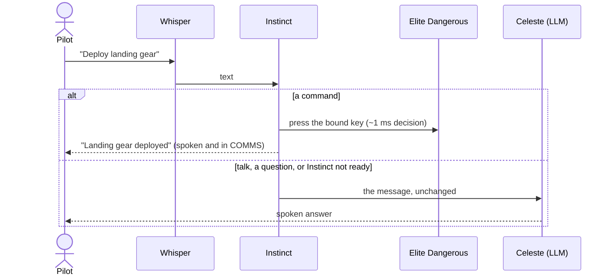
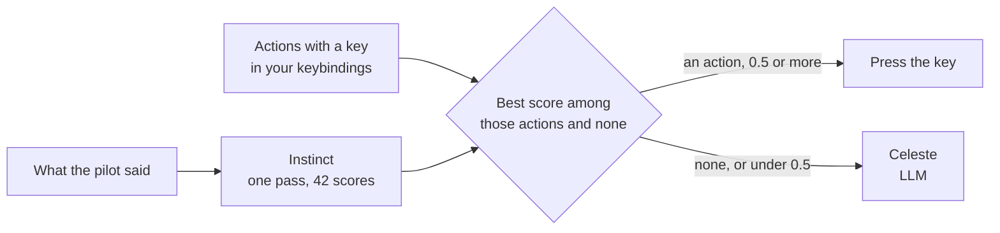
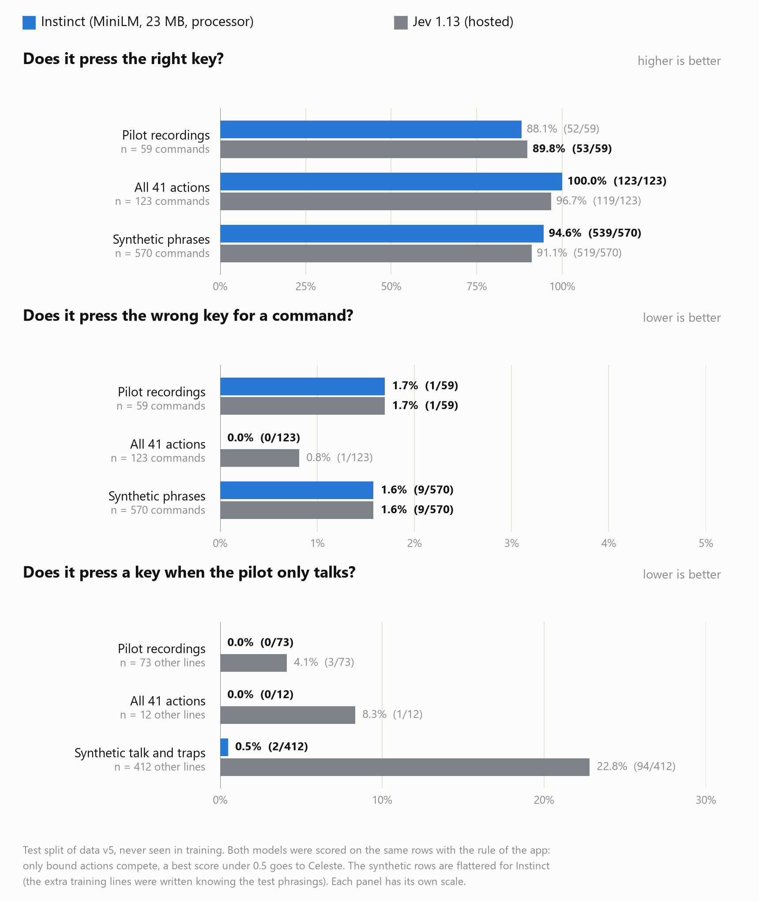

# Instinct, the command model

Instinct is the small model that decides who handles a message: a key press right now, or Celeste. It is [`IqSantiagow/edceleste-command-classifier`](https://huggingface.co/IqSantiagow/edceleste-command-classifier): all-MiniLM-L6-v2 with a 42-class head, in int8 ONNX, 23 MB. It knows the 41 ship actions the app can press and one more class, `none`.

## A voice command

Without Instinct every message goes to the LLM, which takes 5–6 seconds for a single key press. With Instinct, a command takes about a second:

Instinct presses a key only when the model picks a ship action. In every other case the message goes to Celeste as it always did, so nothing gets worse when Instinct is off:

- the model picks `none` or is not sure (best score under 0.5),
- the model is not downloaded or loaded yet,
- the model is too slow (more than 1 s).

When Instinct does pick an action, the reply is short and the same in COMMS and in the speakers:

- **Done:** "Landing gear deployed". A toggle is named after the direction it went.
- **Refused by the ship:** "Landing gear unavailable".
- **Game actions switched off in the settings:** no key is pressed and Celeste says "Game actions disabled". Talk and questions still go to Celeste.
- **Game not running:** "Game window not found, nothing was pressed."

The reply is a clip prepared in the folder of the voice (`voices/<provider>/<profile>/replies/`), so it starts at once. When the clip is missing, for example in a profile cloned before the text was added, Celeste speaks the text live, which is slower.

## How it decides

Instinct is not a chatbot and never writes a sentence. It reads only what the pilot said (which action a command asks for does not depend on the game state) and scores all 42 classes in one pass.

- **Only actions with a key compete.** The best action among the ones you have bound, and `none`, is taken. It cannot press a key that does not exist.
- **There is a threshold of 0.5.** A best score under 0.5 counts as `none`, and the message goes to Celeste. Without it the model presses a key for talk about a ship part it does not understand. The scores of the best options go to the log, only for development.
- **The set of actions is closed.** Each of the 41 actions is a class of the model. An action added to the app later is not known to it: its commands go to Celeste until the model is trained again (about 25 seconds on a graphics card).
- **A second question will guard the door (planned, M1.2).** `needs_llm` will ask whether the message needs knowledge, planning or conversation, so a command combined with a question can be split.

## How well it decides

Instinct is compared with Jev 1.13, a hosted decision model of the same kind (questions in, probabilities out), used as the reference. Both were scored on the same rows of a test split that was never in training, with the rule of the app: only the actions you have bound compete, and a best score under 0.5 sends the message to Celeste.

<picture>
  <source media="(prefers-color-scheme: dark)" srcset="instinct-accuracy-dark.png">
  
</picture>

The numbers behind the chart

| Test | Instinct | Jev 1.13 |
|---|---|---|
| **Recordings of a pilot speaking** (59 commands, 73 other lines) | | |
| Right key pressed | 52 | 53 |
| Wrong key pressed | 1 | 1 |
| Key pressed on a line that is not a command | 0 | 3 |
| **All 41 actions** (123 commands, 12 other lines) | | |
| Right key pressed | 123 | 119 |
| Wrong key pressed | 0 | 1 |
| Key pressed on a line that is not a command | 0 | 1 |
| **Synthetic phrases** (570 commands, 412 other lines) | | |
| Right key pressed | 539 | 519 |
| Wrong key pressed | 9 | 9 |
| Key pressed on a line that is not a command | 2 | 94 |

A command that gets no key goes to Celeste, so a miss costs time, not a wrong key. Five of the seven recordings Instinct gets wrong are Whisper tiny.en mishearing Elite words ("tough launcher" for chaff launcher, "both" for boost).

> **Read these numbers as a good sign, not a guarantee.** 59 commands is a small sample: one command is 1.7 points. It is one pilot, one recording per sentence, and a recording session was looked at while the data was built. A fresh recording session is the clean test and is still to be done. The two synthetic tests are flattered for Instinct: the phrasings of the test split were known when its extra training lines were written. So the recordings are the fair row, and there Instinct and Jev are level.

## What it costs

| Who decides | Where it runs | Time to decide | Memory |
|---|---|---|---|
| Instinct | your processor, one thread | about 1 ms | about 27 MB |
| Jev 1.13 (hosted decision model) | the provider's servers, over the network | about 330 ms | none here |
| Celeste (the LLM) | your LLM provider | about 1.6 s to the first word, 4.3 s at the 95th percentile | none here |

Instinct takes no graphics card memory and one processor thread, so it does not compete with the game. The app waits at most 1 s for it, then the message goes to Celeste.

The times of Instinct were measured with onnxruntime 1.31 on one CPU thread, those of Jev and Celeste on 19 September (Celeste with a free OpenRouter model, so its spread is wide). At log level `INFO` the app logs every decision with its time (`Instinct: ... in N ms`), the number to trust on your machine.

## Using it

- Switch it on in **Settings → LLM → Instinct**. The model (23 MB) is downloaded the first time; after that it needs no network and no API key.
- It presses keys only when **Settings → Game actions** is on, like Celeste's own key presses.

## How it was trained

Instinct starts from [sentence-transformers/all-MiniLM-L6-v2](https://huggingface.co/sentence-transformers/all-MiniLM-L6-v2) (Apache 2.0) with a linear head over 42 classes, fully fine-tuned for 10 epochs (about 25 seconds on a graphics card), then quantized to int8.

- **Data:** the commands and recordings of the `edceleste-decisions` data set, plus about 2,900 phrases written by hand: 22 new phrasings per action, questions and negations about each ship part ("is the landing gear down", "don't touch the cargo scoop"), and talk. A larger model checked the labels, and where it was wrong about a talking line the hand label stayed.
- **What did not help:** a bigger encoder (110M parameters, 5 times the size) gave one more command right of 59. Random noise that imitates speech-to-text slips gave nothing.
- **Why a classifier:** a command needs one answer out of 42, and a 22M model with enough phrasings gives it in a millisecond. Description matching, which would work for an action it never saw, reached only about 70% of such commands in tests, so a new action is trained, not guessed.

The [model card](https://huggingface.co/IqSantiagow/edceleste-command-classifier) has the scores and the limits. The training scripts and data are in the private data set.
